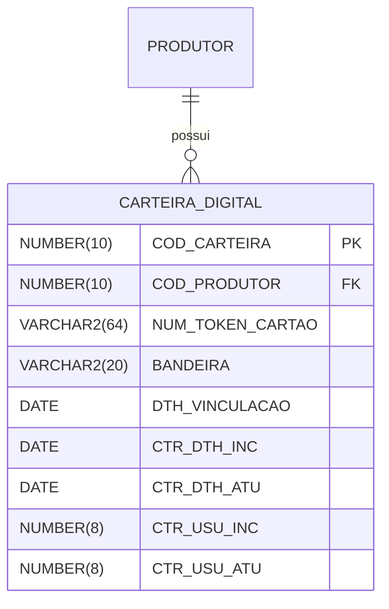

# Modelo de Dados - Módulo Carteira Digital

> **Derivado de:** REQUIREMENTS.md (RN-001, RN-002), LEGACY_CONTEXT.md (TB_CARTAO legada)
> **Última atualização:** 17/11/2026

---

## 1. Diagrama Entidade-Relacionamento

---

## 2. Tabelas

### CARTEIRA_DIGITAL

| Coluna | Tipo | RN | Observação |
|---|---|---|---|
| COD_CARTEIRA | NUMBER(10) PK | — | Chave da carteira |
| COD_PRODUTOR | NUMBER(10) FK | — | Produtor titular |
| NUM_TOKEN_CARTAO | VARCHAR2(64) | RN-001 | Token da vault — o PAN nunca é gravado |
| BANDEIRA | VARCHAR2(20) | — | Bandeira do cartão tokenizado |
| DTH_VINCULACAO | DATE | — | Data da vinculação |
| CTR_DTH_INC | DATE | — | Auditoria |
| CTR_DTH_ATU | DATE | — | Auditoria |
| CTR_USU_INC | NUMBER(8) | — | Auditoria |
| CTR_USU_ATU | NUMBER(8) | — | Auditoria |
| EMAIL_ALTERNATIVO | VARCHAR2(120) | RN-002 | (não usado) — herdada da implementação anterior, sem regra associada |

---

## 3. Decisões de Armazenamento

| Dado | Onde vive | Decisão |
|---|---|---|
| Número do cartão (PAN) | Vault de tokenização do provedor | **Nunca no banco da aplicação** — o banco guarda apenas `NUM_TOKEN_CARTAO` (RN-001) |
| Documentos da carteira | Object storage do provedor | Fora do DATA_MODEL — o banco não replica binários |

---

## 4. Tabelas Legadas (fora do fluxo)

| Tabela | Situação |
|---|---|
| TB_CARTAO (legado) | Mantém a coluna EMAIL_ALTERNATIVO sem uso no fluxo novo (RN-002) — não alimenta a CARTEIRA_DIGITAL |
