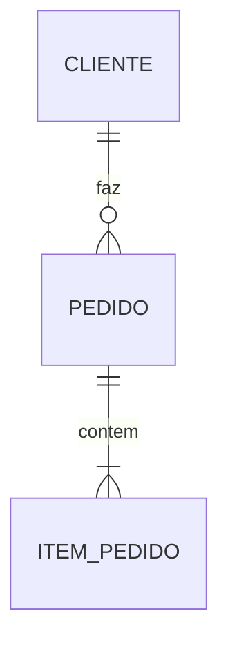

# Modelo de Dados — MeuApp

> Fonte: REQUIREMENTS.md (RN-001, RN-002). Revisão técnica: gm-dba.

## 1. Diagrama Entidade-Relacionamento

## 2. Tabelas

### Tabela `Clientes`

Cadastro de clientes do MeuApp. PK `Id`. Unique `Email`.

### Tabela `Pedidos`

Pedidos emitidos pelos clientes. FK `ClienteId` → `Clientes.Id` (RN-001).

### Tabela `ItensPedidos`

Itens de cada pedido. FK `PedidoId` → `Pedidos.Id` (RN-002).

### Tabela `CuponsDesconto`

Cupons promocionais — spec à frente: entrega futura, ainda sem migration.
