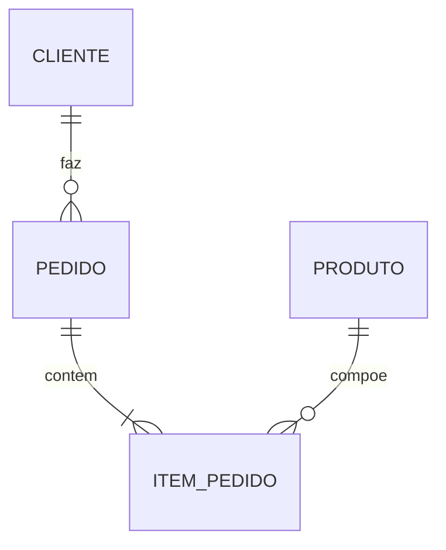

# Modelo de Dados — MeuApp

> Fonte: REQUIREMENTS.md (RN-001, RN-002, RN-003, RN-004). Revisão técnica: gm-dba.

## 1. Diagrama Entidade-Relacionamento

## 2. Tabelas

### Tabela `Clientes`

Cadastro de clientes do MeuApp. PK `Id`. Unique `Email`. Busca por
CPF/CNPJ do titular (RN-001) — coluna `CpfCnpj`.

### Tabela `Pedidos`

Pedidos emitidos pelos clientes. FK `ClienteId` → `Clientes.Id` (RN-002).
Coluna `Status` (Aberto/Fechado) e `CriadoEm` — a listagem por cliente é
dos mais recentes primeiro (RN-002).

### Tabela `ItensPedidos`

Itens de cada pedido. FK `PedidoId` → `Pedidos.Id` (RN-003) e
FK `ProdutoId` → `Produtos.Id`.

### Tabela `Produtos`

Catálogo do MeuApp. PK `Id`. Unique `Sku` (RN-004).

## 3. Decisão de armazenamento

Relacional único (PostgreSQL via EF Core — playbook dotnet). Sem
multi-tenant declarado no charter.
