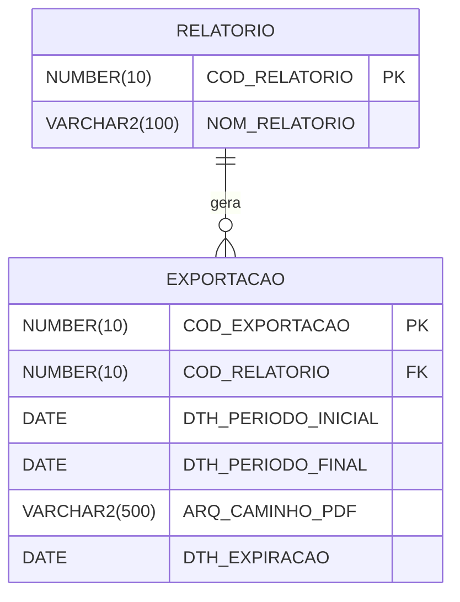

# Modelo de Dados — MeuApp (módulo Relatórios)

> **Derivado de:** REQUIREMENTS.md (RN-001, RN-002)
> **Última atualização:** 01/10/2026

---

## 1. Diagrama Entidade-Relacionamento

---

## 2. Tabelas

### 2.1 RELATORIO

Tabela **nova** para cadastro de relatórios disponíveis (RN-001).

### 2.2 EXPORTACAO

Tabela **nova** para histórico de exportações (RN-001, RN-002).
As colunas de período atendem o filtro de data inicial/data final (RN-002);
`ARQ_CAMINHO_PDF` aponta para o arquivo no armazenamento de objetos com
validade de 24 horas (RN-001).

---

## 3. Decisão de armazenamento

- Banco relacional do MeuApp.API (mesma instância das tabelas de negócio).
- Os PDFs gerados ficam em armazenamento de objetos; a tabela guarda
  apenas o caminho do arquivo e a data de expiração.
