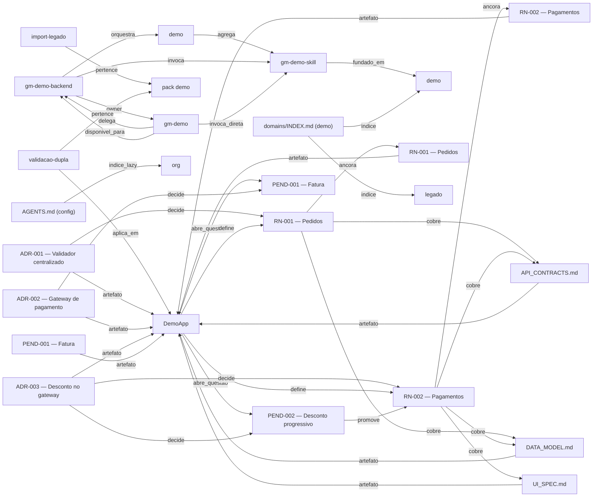

# Grafo do Conhecimento (T1-T5)

> Gerado por gm-knowledge-graph (scripts/build-knowledge-graph.mjs — determinístico).
> Gerado em 2026-11-20T19:58 · modo: global · escopo: DemoApp

## Contagem por tipo

| Tipo | Nós |
|---|---|
| t1_dominio | 2 |
| t1_indice | 1 |
| t2_pack | 1 |
| t2_pattern | 2 |
| t3_rule | 1 |
| t4_adr | 3 |
| t4_feature | 3 |
| t4_modulo | 1 |
| t4_pend | 2 |
| t4_rn | 2 |
| t4_spec | 3 |
| t5_config | 1 |
| t5_dominio | 1 |
| t5_primary | 1 |
| t5_skill | 1 |
| t5_subagent | 1 |

**Arestas:** 39

**Bases T1 stale:** legado

## Mermaid (top 26 nós por grau)

## Avisos (1)

- dir ausente para fundado_em: config/agents
