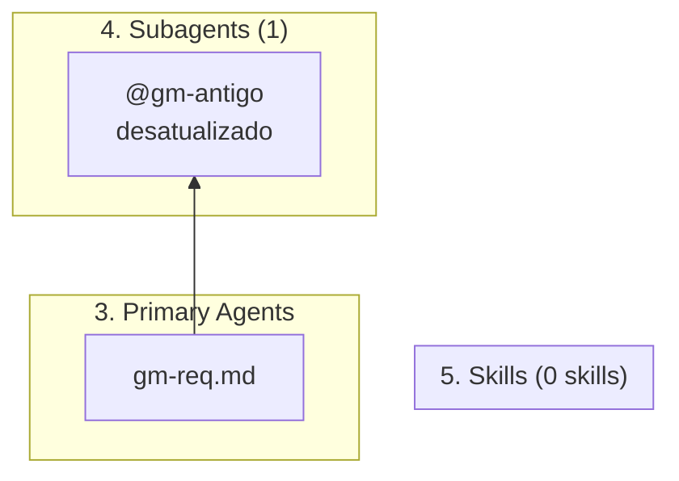
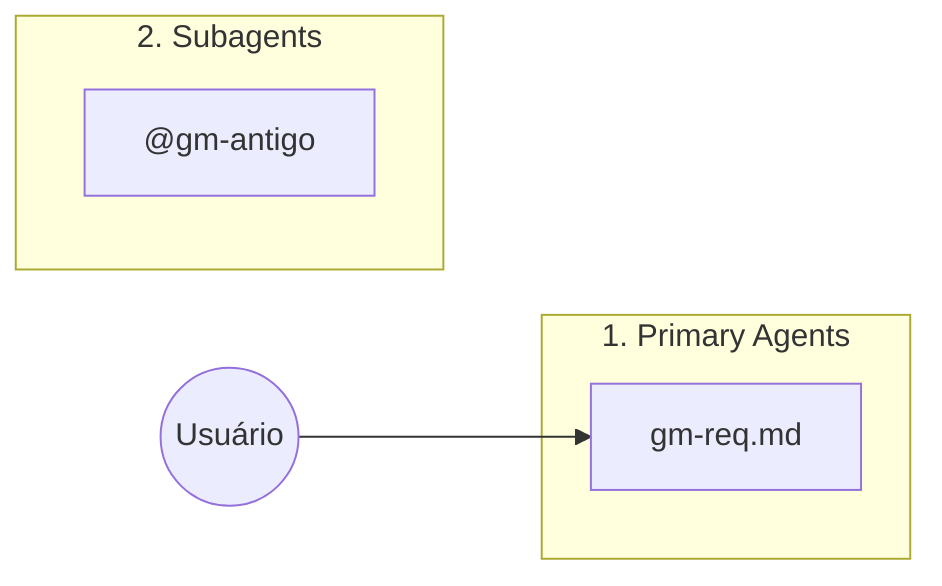

# ARCHITECTURE — Config do engine (fixture de eval)

## Visão geral

Este documento segue a árvore de delegação canônica do `registry.yaml`.
As seções estruturais (§1-§6) são geradas pelo gm-registry-render dentro
dos marcadores BEGIN/END_REGISTRY — edições manuais dentro do bloco são
sobrescritas; seções narrativas fora dos marcadores são preservadas.

<!-- BEGIN_REGISTRY -->
## 1. Diagrama de camadas

## 2. Diagrama de interações

## 3. Primary Agents

| Primary | Descrição | Delega para | Invoca diretamente |
|---------|-----------|-------------|--------------------|
| `gm-req` | Requisitos | (bloco desatualizado) | — |

## 4. Subagents

| Subagent | Descrição | Invoca skills | Owner | Disponível para |
|----------|-----------|---------------|-------|-----------------|
| `@gm-antigo` | desatualizado | — | `gm-req` | `gm-req` |

## 5. Skills por domínio

### 5.1 (vazio — bloco desatualizado)

## 6. Taxonomia de domínios

| Domínio | Orquestrador padrão | Skills |
|---------|---------------------|--------|
| (bloco desatualizado) | — | — |
<!-- END_REGISTRY -->

## Convenções

IDs no padrão FORMAT (RN-NNN, PEND-NNN, IMP-NNN). Diagramas mermaid
regenerados a cada render — colisão de ID de nó nunca é emitida.
